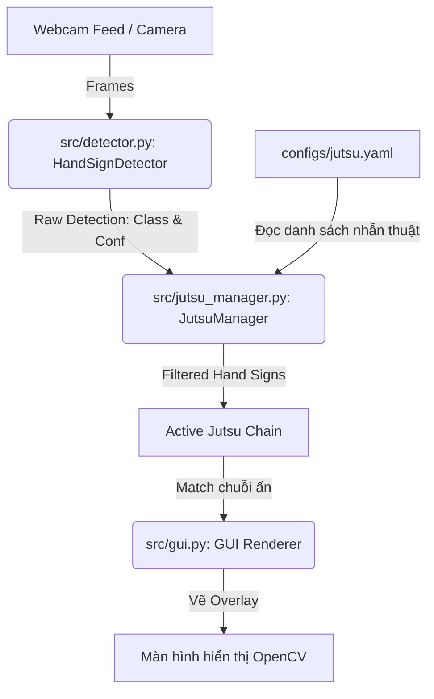

# Tài liệu Thiết kế Hệ thống: Nhận diện Thủ ấn Naruto (Real-time Jutsu Detection)

Tài liệu này chứa đựng toàn bộ thiết kế kiến trúc, cấu trúc thư mục, luồng xử lý và nhật ký quyết định đã được thống nhất giữa bạn và tôi. Tài liệu này sẽ đóng vai trò là "kim chỉ nam" cho việc triển khai mã nguồn tiếp theo.

---

## 1. Tóm tắt Yêu cầu & Phạm vi Dự án (Understanding Summary)
* **Mục tiêu:** Xây dựng một ứng dụng chạy trên máy tính cá nhân nhận diện chuỗi thủ ấn Naruto thời gian thực thông qua Webcam và hiển thị tên nhẫn thuật tương ứng khi người dùng thi triển đúng chuỗi.
* **Đối tượng sử dụng:** Lập trình viên thử nghiệm thị giác máy tính tương tác, người hâm mộ anime Naruto.
* **Công nghệ cốt lõi:** YOLOv8 Nano (`yolov8n.pt`), OpenCV, Python.
* **Phạm vi (In-scope):**
  * Script cấu hình huấn luyện model YOLOv8 Nano cục bộ, sẵn sàng đưa lên Google Colab để train GPU.
  * Bộ lọc lọc nhiễu thời gian thực (temporal filter) để xử lý luồng nhận diện từ camera.
  * File cấu hình quản lý danh sách nhẫn thuật bên ngoài.
  * Giao diện đồ họa OpenCV tối giản hiển thị webcam và overlay chữ nhẫn thuật rực rỡ.
* **Ngoài phạm vi (Explicit Non-goals):**
  * Không tích hợp âm thanh ở giai đoạn hiện tại (YAGNI).
  * Không làm ứng dụng di động hay ứng dụng web server-side.
  * Không dựng hiệu ứng 3D phức tạp.

---

## 2. Nhật ký Quyết định (Decision Log)

| STT | Quyết định đã chọn | Giải pháp thay thế cân nhắc | Lý do lựa chọn giải pháp này |
| :--- | :--- | :--- | :--- |
| **1** | **YOLOv8 Nano (`yolov8n.pt`)** | YOLOv8 Small / Medium | Đảm bảo tốc độ inference cực nhanh (> 30 FPS) mượt mà trên CPU máy tính cá nhân mà không đòi hỏi GPU đắt tiền khi chạy ứng dụng thực tế. |
| **2** | **Quản lý nhẫn thuật qua `jutsu.yaml`** | Hardcode nhẫn thuật trong code | Giúp hệ thống linh hoạt, dễ bảo trì. Bạn có thể thêm/sửa nhẫn thuật bất kỳ lúc nào mà không cần chỉnh sửa hay biên dịch lại code Python. |
| **3** | **Bộ lọc Temporal Filter & Debounce** | Kích hoạt thủ công qua phím bấm | Tự động hóa trải nghiệm. Lọc bỏ hoàn toàn các khung hình nhận diện sai ngẫu nhiên khi tay di chuyển nhanh và tránh hiện tượng lặp từ khóa khi giữ nguyên tay. |
| **4** | **Không phát âm thanh ban đầu** | Tích hợp thư viện phát âm thanh | Tối giản hóa kiến trúc ban đầu. Tập trung hoàn thành phần lõi là AI và Logic Nhẫn thuật trước khi thêm các tính năng bổ sung. |
| **5** | **Giao diện OpenCV GUI** | Giao diện PyQt / PySide / Tkinter | OpenCV GUI tích hợp sẵn trong luồng xử lý ảnh, siêu nhẹ, không cần cài đặt các framework GUI cồng kềnh, dễ dàng vẽ overlay bounding box và text thời gian thực. |

---

## 3. Kiến trúc Hệ thống & Luồng Dữ liệu (Architecture & Data Flow)

### 3.1. Sơ đồ các thành phần (Component Diagram)


### 3.2. Thuật toán Lọc nhiễu & Gom chuỗi (Temporal Filtering Algorithm)
```text
[Bắt đầu Frame mới]
       |
  Đọc nhãn từ YOLOv8n (ví dụ: 'tiger')
       |
  Có vượt ngưỡng Confidence (50%) không?
      / \
   Có/   \Không -> Bỏ qua frame
    /
  Nhãn này có TRÙNG với nhãn đang theo dõi (tracking_sign) không?
      / \
   Có/   \Không -> Đặt tracking_sign = 'tiger', reset frame_counter = 1
    /
  Tăng frame_counter lên 1 đơn vị.
  frame_counter đã ĐẠT MỨC TỐI THIỂU (ví dụ: 5 frames liên tục) chưa?
      / \
   Có/   \Không -> Tiếp tục chờ frame tiếp theo
    /
  Nhãn 'tiger' này có KHÁC với nhãn được ghi nhận cuối cùng (last_recorded_sign) không?
      / \
   Có/   \Không -> Bỏ qua (Tránh lặp lại một thủ ấn đang được giữ nguyên)
    /
  Đẩy 'tiger' vào chuỗi tích lũy current_chain!
  Cập nhật last_recorded_sign = 'tiger'
  Cập nhật last_action_time = thời gian hiện tại
  Reset frame_counter = 0
       |
  So khớp current_chain với configs/jutsu.yaml
      / \
   Có/   \Không -> Tiếp tục chờ ấn tay tiếp theo (hoặc Tự động xóa chuỗi nếu quá 3 giây không hành động)
    /
  KÍCH HOẠT NHẪN THUẬT THÀNH CÔNG! -> Kích hoạt trạng thái hiển thị hiệu ứng GUI & Tự động reset current_chain = []
```

---

## 4. Kế hoạch Cấu trúc Thư mục Chi tiết
Dự án sẽ được triển khai theo cấu trúc thư mục modular sau:
```text
naruto-hand-detect/
├── configs/
│   ├── data.yaml            # Cấu hình dataset trỏ đến YOLOv8 data
│   └── jutsu.yaml           # Cấu hình nhẫn thuật và chuỗi ấn tay đi kèm
├── src/
│   ├── __init__.py
│   ├── train.py             # Script chuẩn bị cấu hình để train trên Google Colab
│   ├── detector.py          # Class HandSignDetector tải model, chạy inference
│   ├── jutsu_manager.py     # Class JutsuManager lọc nhiễu, quản lý chuỗi, check nhẫn thuật
│   └── gui.py               # Module hỗ trợ vẽ overlay giao diện lên khung hình
├── main.py                  # File khởi chạy webcam và ghép nối toàn bộ ứng dụng
├── requirements.txt         # File cài đặt thư viện cần thiết
└── DESIGN.md                # Tài liệu thiết kế này
```

---

## 5. Kế hoạch Xác minh & Thử nghiệm (Verification Plan)
1. **Kiểm tra Huấn luyện:** Chạy `src/train.py` cục bộ với `epochs=1` để kiểm tra toàn bộ luồng đọc file cấu hình và tải model không gặp lỗi đường dẫn, sau đó mới upload toàn bộ dự án lên Google Colab để train chính thức.
2. **Kiểm tra Logic:** Viết một script test nhỏ trong `src/jutsu_manager.py` để kiểm thử độc lập thuật toán Temporal Filtering (truyền giả lập chuỗi nhãn thô và kỳ vọng chuỗi ấn lọc được và tên nhẫn thuật trả về chính xác).
3. **Kiểm tra Tích hợp Webcam:** Chạy `main.py` trên máy local, thực hiện các thủ ấn trước camera và đo đạc chỉ số FPS thực tế (mục tiêu là đạt tối thiểu 20-30 FPS).
